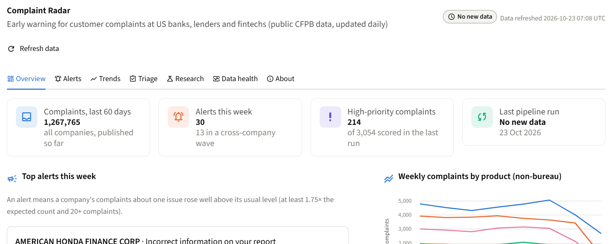
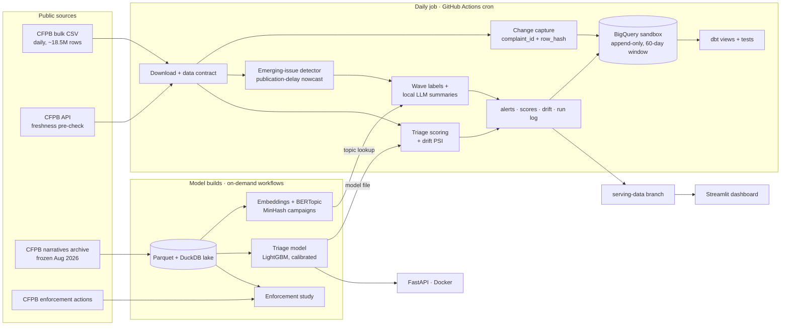

# Complaint Radar

**An early-warning system for customer complaints at banks, lenders and fintechs.** Every day it ingests the US
CFPB complaint database, spots issues that are growing unusually fast at a company, explains them with real
example complaints, scores which complaints are likely to end in relief, and tests whether complaint patterns
warn of regulatory enforcement.

**Live dashboard:** [complaint-radar.streamlit.app](https://complaint-radar.streamlit.app) · daily pipeline on
GitHub Actions → BigQuery · everything runs at ₹0 on free tiers.



## Results at a glance

| Question | Answer (tested on data the models never saw) |
|---|---|
| Would it have flagged real incidents early? | **90%** of 161 non-bureau incidents caught; median warning **14 days** before the peak; 45% flagged ≥ 14 days early (enough to survive the CFPB's publication delay). MOHELA's 2022 servicing failures: **35 days** early. The simple volume rule beat two statistical detectors. → [phase 3](docs/results/phase3.md) |
| How much of the volume is genuine? | **20%** of past incidents were mostly near-identical template texts (Block/Cash App Jan 2025: 94% copies). 21 of 27 such waves happened in 2024–26. → [phase 4](docs/results/phase4.md) |
| What are complaints about? | 61 topics discovered from narratives; the complaint text predicts the topic with 71% accuracy, against 28% from product + issue alone. |
| Can we triage complaints? | Reviewing the model's top 10% first finds **53%** relief cases against 17.5% at random: **3.0× lift**, 2× the baseline. ROC-AUC 0.78 on 2025. The narrative text adds nothing over the structured fields. → [phase 5](docs/results/phase5.md) |
| Do complaints warn of enforcement? | **No, beyond company size.** Complaint volume alone ranks sanctioned companies well (top 1%: **12.6×** the base rate, 2020–24), but growth, relief rates and issue shifts add nothing (PR-AUC gain −0.018, 95% CI −0.048 to +0.007). Negative result, reported as such. → [phase 6](docs/results/phase6.md) |
| Does the pipeline hold up? | Daily, idempotent (a re-run appends 0 rows), contract-checked, change-capturing loads into the BigQuery sandbox with no DML; 149 tests; CI builds and smoke-tests the API container. |

## Architecture



## Why the design is "hybrid"

On **14 Aug 2026 the CFPB stopped publishing complaint narratives**. The daily feed is now structured-only (15
columns); the text survives in a frozen official archive (Dec 2011 – Aug 2026, 3.85M narratives). So:

- **Alerts** come from the live structured feed.
- **Explanations, topics and text features** come from the archive and are linked to live alerts through
  product × issue.

The removal is also a textbook upstream data-contract break, and the pipeline's contract checks would have
stopped the load on that day (see [runbook](docs/runbook.md)).

## Quick start

The heavy jobs run on GitHub Actions, so nothing has to run locally:

| Workflow | What it does |
|---|---|
| `Daily pipeline` | Runs every day at 11:30 UTC; can also be started manually |
| `Build text models` | Topics, campaign analysis and the topic lookup |
| `Train triage model` | Trains and evaluates the escalation-triage model |
| `Enforcement study` | Scrapes enforcement actions and runs the early-warning study |

Local development (Python 3.13, [uv](https://docs.astral.sh/uv/)):

```powershell
$env:UV_PROJECT_ENVIRONMENT = "$env:USERPROFILE\.venvs\complaint-radar"   # keep the venv outside synced folders
uv sync                                  # add --group text for topic modelling (CPU-only torch)
uv run pytest                            # 149 tests: pipeline, detectors, models, API, dashboard
uv run complaint-radar --help            # download-archive, backfill-archive, run-daily, backtest, ...
uv run streamlit run dashboard/app.py    # dashboard against the published serving data
docker build -t complaint-radar-api . && docker run -p 8000:8000 complaint-radar-api   # POST /score
```

The daily job needs a Google service-account key (BigQuery Data Editor + Job User) in the `GCP_SA_KEY` secret.

## How it works

**1. Ingestion and data quality** ([phase 1](docs/results/phase1.md), [phase 2](docs/results/phase2.md))
- **Pre-check:** the API's newest complaint date must have moved since the last good run; if it hasn't, the
  run records `no_new_data` and stops.
- **Download and contract check:** the official bulk snapshot is checked against a YAML **data contract**
  (required columns, unique IDs, allowed values, freshness, row-count jumps) before anything loads.
- **Change capture without DML:** the BigQuery sandbox has no MERGE or UPDATE. So new and *changed*
  complaints are appended as versions, matched on `(complaint_id, row_hash)`, and dbt views pick the latest
  version per complaint.
- **Safe re-runs and backfills:** re-runs are idempotent, `backfill --since` re-captures after an outage, and
  the sandbox's 60-day table expiry is handled automatically.
- **Run log and runbook:** every run (success, no data or failure) is written to `pipeline_runs`, and the
  [runbook](docs/runbook.md) says what to do in each failure case.

**2. Emerging-issue detection** ([phase 3](docs/results/phase3.md))
- **Detectors:** weekly series per company × product × issue, each against an 8-week baseline. A simple volume
  rule, a robust z-score and a negative-binomial surprise score were compared at equal false-alarm budgets.
- **Backtest:** on real incidents, with thresholds tuned on 2016–21 and results reported on 2022–26.
- **Publication-delay nowcast:** the CFPB publishes most complaints only after the company responds, so last
  week is only about 28% visible. Each week is compared with baseline × its estimated completeness (per
  product), and is scored only once it is at least half published. Daily snapshots of completeness are
  stored so the nowcast can be calibrated over time.

**3. Text** ([phase 4](docs/results/phase4.md))
- **Campaign detection:** a NumPy MinHash + LSH near-duplicate detector separates template campaigns from
  organic incidents.
- **Topics:** MiniLM embeddings + BERTopic on a stratified 40k sample, distilled to 1.05M narratives with
  TF-IDF + logistic regression.
- **Summaries:** written by a local `qwen2.5:1.5b` model (Ollama, CPU). A summary is accepted only if every
  number in it is in the alert's facts; otherwise a template is used. Complaint text is fenced as untrusted
  input.

**4. Escalation triage** ([phase 5](docs/results/phase5.md))
- **Model:** LightGBM on intake-time fields only, with isotonic calibration on 2024 and testing on 2025.
- **Scoring API:** FastAPI `/score` returns a probability, a priority and the top three reasons (SHAP values),
  packaged in Docker with a CI smoke test.
- **Drift monitoring:** a daily PSI of the product mix and the score distribution.

**5. Enforcement study** ([phase 6](docs/results/phase6.md))
- **Data:** CFPB enforcement actions are scraped and matched to complaint companies (multi-party name
  splitting, brand and parent rules, reviewed overrides).
- **Design:** a company-month panel whose features come only from the prior 12 months. Months right after an
  action are excluded, because complaint waves often *follow* public actions.
- **Test:** train on 2015–18, test on 2020–24 with no overlapping labels, compared with complaint volume
  alone, with a company-clustered bootstrap.
- **Result:** 262 actions, 46 sanctioned companies in the test years. Volume alone: PR-AUC 0.156; best
  pattern model: 0.136. Patterns do not warn of enforcement beyond company size.

## Testing and CI

- **pytest (149 tests):** contracts, normaliser, change capture and idempotency, the daily run with fakes
  (no network), detectors and backtest maths, the nowcast, MinHash, LLM grounding guards, triage leakage
  guards, drift, name matching, the API, and a headless run of the whole dashboard (with and without data).
- **dbt tests:** keys, accepted values, grain, reconciliation and unit tests.
- **CI on every push:** lint, tests, dbt on a fixture lake, and a Docker build + smoke test. Failing tests are
  surfaced as annotations.

## Limits

- CFPB complaints are unverified and not a random sample of customers.
- **No live text since Aug 2026:** topics and examples come from complaints published before then.
- **The public feed lags 1–3 weeks**, so early warnings arrive later than they would inside a bank, and
  "intake" triage scores are retrospective on public data.
- **Statistical incidents:** incidents are defined statistically, not as confirmed business problems. The
  enforcement study is low-powered, because there are few sanctioned companies per year.
- **BigQuery sandbox:** 10 GiB lifetime storage and a 60-day expiry; see the storage projection in
  [phase 2](docs/results/phase2.md).

## Applying this in India

The same architecture fits Indian banks, NBFCs and UPI apps. The main changes are the data sources and the
language models.

**Data sources**
- Complaints against regulated entities go through each bank's internal grievance redressal and internal
  ombudsman. Escalations go to the **RBI Integrated Ombudsman Scheme (2021)** via the CMS portal. UPI
  disputes follow NPCI's dispute-resolution framework (UDIR).
- RBI publishes ombudsman statistics only as aggregates, so a bank would run Complaint Radar on its **own**
  complaint stream: branch, call-centre, app and CMS-forwarded complaints.

**How the parts carry over**
- **Text comes back:** internal complaint streams keep the free text the CFPB removed. The narrative-based
  parts (topics, campaign detection, summaries) then run on live data, not an archive.
- **Language:** complaints mix Hindi, English and regional languages. That calls for a multilingual
  embedding model (e.g. multilingual MiniLM, MuRIL or IndicBERT) and a multilingual summary model.
- **Fast-moving incidents:** UPI failures, wrong debits and app outages spike within hours. Daily or hourly
  series with the same volume rule and campaign check would separate an outage from a social-media complaint
  drive.
- **Regulatory deadlines:** under the RBI scheme a complaint can be escalated if unresolved after 30 days.
  That makes escalation triage directly useful: score each complaint at intake for the likelihood that it
  ends with the ombudsman, and prioritise those.

## Project layout

```
src/complaint_radar/   ingest · contracts · pipeline · storage · detect · text · summarize · triage · enforcement · monitor · serving · api
dbt/                   staging → marts (DuckDB) and warehouse views (BigQuery), with tests
dashboard/             Streamlit app
docs/                  design, data exploration, runbook, results per phase
.github/workflows/     ci · daily · text-models · train-triage · enforcement
```
