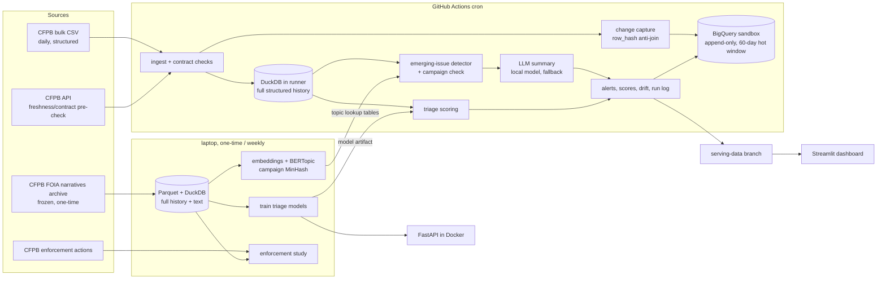

# Complaint Radar — design

Status: draft for review · Date: 2026-10-21 · Owner: Larissa Martis

## 1. Purpose

Financial companies hear about new problems (an app bug, a fraud wave, a servicing backlog) in customer
complaints days or weeks before management does. Complaint Radar ingests public US CFPB complaints every
day, finds issues that are growing unusually fast per company, explains them in plain English with real
example complaints, scores which complaints are likely to end with the company giving relief, and tests
whether complaint patterns warn of regulatory enforcement in advance.

Success means:
- A daily pipeline that runs unattended, is safe to rerun, and fails loudly when the source changes.
- Early-warning results backtested on real past incidents, reported with lead time and false-alarm rate.
- Every model compared with a simple baseline, with negative results reported as plainly as positive ones.
- Total cost ₹0.

## 2. What the data exploration found (and why it shapes the design)

Explored 2026-10-21. Full numbers are in `docs/data_exploration.md`.

| Finding | Design consequence |
|---|---|
| CFPB stopped publishing narratives on 2026-08-14. The live API and daily bulk CSV now have structured fields only (15 columns). | **Hybrid design:** live structured feed for detection; frozen text archive for topics, summaries and text features. |
| Official FOIA narratives archive: 21 zips, 1.43 GB, Dec 2011–14 Aug 2026, 17.5M rows, 3.85M narratives (text from 2015). | One-time backfill. The archive is the text corpus. |
| Even before the change, text was published with a lag of weeks to months (Feb 2026 complaints: 2.4% had text when archived). | Text can never be the *trigger* for a real-time alert. Structured counts raise the alarm; text *explains* it. |
| About 94% of recent complaints are about three credit bureaus (TransUnion, Experian, Equifax). 30% of their narratives are word-for-word templates (top one copied 27,496 times). | Bureaus are a separate monitoring segment and are excluded from topic and triage training. A campaign detector separates template waves from organic incidents. |
| Real spikes exist: MOHELA Oct 2022 (12×, "TEACH Grant" account bug), PayPal Mar 2021 (3.5×, 180-day holds), Chime Feb–Apr 2025 (3×), Block Jan 2025 (96×, half the texts duplicated, so likely a campaign). | Backtest set of real incidents. |
| Wells Fargo Jan 2023 and Capital One / Block Jan 2025 spikes come *after* CFPB actions. | The enforcement study must only use data from before each action (leakage control). |
| Company response for non-bureau complaints since 2023: 80% closed with explanation, 13.5% non-monetary relief, 4.3% monetary relief, 1.2% untimely. "Consumer disputed?" was retired in 2017. | Triage label = "company gave relief" (about 18% positive). |
| About 55% of the newest complaints are still "In progress"; their response changes later. | Ingestion must capture *changes* to existing complaints, not only new IDs. |

## 3. Key decisions

| # | Decision | Why |
|---|---|---|
| D1 | **Python 3.13**, managed with `uv`; venv at `%USERPROFILE%\.venvs\complaint-radar`. | dbt-duckdb, dbt-bigquery, BERTopic and sentence-transformers are certified only up to 3.13. Same version in CI. |
| D2 | **Two-tier storage.** Local "lake" = Parquet + DuckDB with full history and text (`%USERPROFILE%\data\complaint-radar`, outside OneDrive). Cloud warehouse = BigQuery sandbox holding a rolling 60-day "hot" window plus daily outputs. | The sandbox allows no DML (no MERGE/UPDATE), expires every table/partition after 60 days, and has a 10 GiB *lifetime* storage cap. Full history cannot live there. |
| D3 | **Append-only, change-capture loads into BigQuery.** Each day, load only rows whose `(complaint_id, row_hash)` is not already present, into a date-partitioned table using load jobs (not DML). "Current state" = a dbt view taking the latest version per complaint. | Works without MERGE, makes reruns idempotent (a rerun appends nothing), keeps full change history, and stays around 3 MB/day so the 10 GiB lifetime cap lasts years. |
| D4 | **Daily source = the official bulk CSV snapshot** (about 356 MB zip, all history), not API paging. | One request and complete. It lets the job recompute history in DuckDB inside the runner and catch status changes on old complaints. The API is used only for a cheap freshness and contract pre-check. |
| D5 | **dbt** with two targets: `duckdb` (local, full history) and `bigquery` (cloud, views only). | Same SQL models and tests in both places. Views use no storage, and table models in BigQuery would hit the no-DML/expiry limits. |
| D6 | **Orchestration: GitHub Actions cron (daily) running a Python CLI** with explicit steps, retries, a `pipeline_runs` log and alert records. | Free, reliable, no server to keep alive. The step structure maps one-to-one to an Airflow DAG (noted in the README). A self-hosted orchestrator would need an always-on machine, which is not free. |
| D7 | **Data contracts** in YAML (columns, types, allowed values, row-count and freshness bounds), checked before anything is loaded. A failed contract stops the run and writes a dated incident record. | The 2026 narrative removal is a real example of an upstream contract break. The README walks through how this system would have caught it. |
| D8 | **Emerging-issue detection on structured series** (segment × company × product × issue, daily, aggregated weekly). | Live text no longer exists, and structured series are what a real early-warning system would trigger on anyway. |
| D9 | **Text models from the archive:** CPU sentence embeddings (`all-MiniLM-L6-v2`) + BERTopic on non-bureau unique narratives (2019 onwards, about 1.1M), computed once and cached. Topics are linked to product/issue/sub-issue, so a live alert shows "what people typically describe" with real example complaints. | Gives real topic discovery within laptop limits (one-time 2–3 h CPU job), and connects frozen text to live alerts honestly. |
| D10 | **Campaign detector:** MinHash near-duplicate clustering on text (archive) plus a structured burst signature (same company + sub-issue + response pattern in a short burst) for live data. Alerts are labelled `organic` or `possible campaign`. | Template floods are 30% of bureau text and explain the Block 2025 spike. Reporting them as product failures would be a false alarm. |
| D11 | **LLM summaries with a local open model** (Ollama, `qwen2.5:1.5b`, CPU). Runs in the daily job for at most 10 alerts, with a template fallback if the model fails or times out. | ₹0, no paid API, and a graceful fallback (a production habit). The model gets the alert statistics plus retrieved example complaints, and is told not to invent facts. |
| D12 | **Escalation triage:** label = relief given (monetary or non-monetary). Two models: *structured-only* (usable live) and *structured + text* (archive). Logistic regression and LightGBM, calibrated, time-based split. Baseline = historical relief rate per product × issue. | Shows text adds value (or not) with an honest comparison. Calibrated probabilities make it usable for a queue. |
| D13 | **Enforcement study** on a company-month panel: target = a CFPB public enforcement action in the next 6 / 12 months. Features use only complaints from before the month (relief rate, untimely rate, growth, issue-mix shift, topic shift). Train ≤ 2019, test 2020+, with rolling origin. Baseline = raw complaint volume. Reports PR-AUC and precision@k. | The strict time split plus excluding post-action months prevents the "spike after the fine" leakage seen in exploration. The result is reported even if weak. |
| D14 | **Company name matching** between enforcement actions and complaint company names: normalise + fuzzy match + a small reviewed mapping file. | A real data-engineering entity-resolution task, done transparently. |
| D15 | **Serving:** FastAPI (`/health`, `/alerts`, `/score`) in Docker, built and tested in CI. Streamlit dashboard on Streamlit Community Cloud, reading small serving files that the daily job writes to an orphan `serving-data` branch. | Keeps `main` history clean, gives the dashboard daily fresh data for free, and the git branch is the durable alert log (BigQuery data expires after 60 days). |
| D16 | **Monitoring:** daily volume and mix drift (PSI on product/issue/company shares), triage score distribution drift, and pipeline freshness. These are written as dated records and shown on the dashboard. | Basic MLOps that a reviewer can see working. |

## 4. Architecture



## 5. Components (each one has a single job)

Repository layout:

```
complaint-radar/
  src/complaint_radar/
    ingest/        download snapshot, API pre-check, archive backfill
    contracts/     YAML contracts + checker
    storage/       DuckDB lake, BigQuery loader (load jobs only)
    detect/        series building, detectors, campaign signature, backtest
    text/          embeddings, topics, MinHash near-duplicates, topic lookup
    summarize/     prompt building, Ollama client, template fallback
    triage/        features, training, calibration, scoring
    enforcement/   actions scraper, name matching, panel, evaluation
    monitor/       drift + freshness checks
    api/           FastAPI app
    cli.py         `complaint-radar run-daily | backfill | ...`
  dbt/             staging → intermediate → marts, with tests (duckdb + bigquery targets)
  dashboard/       Streamlit app
  contracts/       complaints_snapshot.yml
  tests/           pytest (unit + small fixtures; no network)
  docs/            design, data_exploration, runbook, results
  .github/workflows/  ci.yml, daily.yml
  Dockerfile
```

Key interfaces:
- `ingest.snapshot.fetch(date) -> Path` (downloads the zip once per day; cached).
- `contracts.check(df, contract) -> ContractResult` (pass/fail plus a list of violations).
- `storage.bq.append_changes(df, run_id)` (anti-join on `(complaint_id, row_hash)` against the hot window, then a load job).
- `detect.run(series, as_of) -> list[Alert]`. Each `Alert` has: id, as_of date, segment, company, product, issue, observed, expected, score, detector, campaign_flag.
- `summarize.explain(alert, examples) -> Summary` (LLM or template; records which was used).
- `triage.score(records) -> probabilities` (versioned model artifact).

## 6. Data flow — daily run

1. **Pre-check:** the API returns the newest `date_received`. If it hasn't advanced, the run is marked `no_new_data` (not a failure).
2. **Download** the bulk snapshot, then **contract check** (schema, allowed values, row count within ±20% of yesterday, newest date within 3 days). On failure: stop, write an incident record, and fail the job, which sends GitHub's email.
3. **Load** the snapshot into DuckDB in the runner. Compute `row_hash` over the business columns.
4. **Change capture:** new or changed rows are appended to BigQuery `raw_complaint_versions` (partitioned by `loaded_date`).
5. **dbt build** (views in BigQuery, tests run as queries).
6. **Detect** on full structured history, then run the campaign check, then summarise the top alerts.
7. **Score** new complaints with the structured-only triage model.
8. **Monitor** drift and freshness.
9. **Publish:** append alerts, scores and the run log to BigQuery and the `serving-data` branch.
10. **Backfill:** `complaint-radar backfill --from --to` replays steps 3–9 for past dates using the archive / snapshot (`as_of` date logic, no peeking at future data). It is idempotent for the same reason as step 4.

## 7. Emerging-issue detection

- **Unit:** weekly counts per (segment, company, product, issue). Bureaus get their own segment and baselines.
- **Detectors**, compared against each other:
  - **Baseline:** raw-volume rule (this week > 2× the trailing 8-week mean, minimum count 20).
  - **Robust z-score** vs trailing median / MAD with a day-of-week-adjusted expectation.
  - **Poisson/negative-binomial surprise** (how unlikely this count is given the trailing rate), with an EWMA/CUSUM for slow growth.
  - **New-combination detector:** a company × issue pair with near-zero history suddenly appearing.
- **Backtest:**
  - Incidents = a hand-verified list (MOHELA 2022/2023, PayPal 2021, Chime 2025, and others found systematically) plus auto-detected peaks.
  - Metrics: share of incidents caught before the peak, median lead time in days, and false alarms per 100 series-months.
  - Thresholds are tuned on 2017–2021 and reported on 2022–2025.

## 8. Error handling and operations

- Every step logs to a `pipeline_runs` record (run_id, step, status, rows, duration, error).
- **Retries:** 3 with backoff for network steps. Contract failures are not retried.
- **LLM step:** a timeout leads to the template fallback. This is never a pipeline failure.
- **BigQuery outage or quota error:** outputs still go to the `serving-data` branch, and the job is marked `degraded`.
- `docs/runbook.md` covers: the daily load failed, contract failed (source changed), no new data, quota exceeded, a backfill needed, and rotating the service-account key.

## 9. Testing

- **pytest** for: contract checker, row-hash/change capture (rerun appends 0 rows), detectors on synthetic series with known spikes, campaign MinHash on synthetic templates, triage feature leakage guard, name matching, and API endpoints (TestClient).
- **dbt tests:** unique/not-null keys, accepted values, freshness, and a custom "latest version per complaint is unique" test.
- **CI on every push:** ruff, pytest, dbt build on a small DuckDB fixture, and Docker build plus an API smoke test.

## 10. Limits (stated in the README)

- No live text since 2026-08-14. Text-based explanations come from historical complaints that match the same product/issue.
- CFPB complaints are not verified and are not a random sample of customers.
- The BigQuery sandbox keeps only 60 days of history in the cloud. Full history lives in the local lake and is recomputed daily from the bulk snapshot.
- Enforcement actions are rare (a few hundred), so that study is low-powered and is presented as research, not a product feature.

## 11. Build phases

1. Foundation: repo, env, archive backfill into the local lake, contracts, dbt (duckdb), tests, CI.
2. Daily pipeline: snapshot ingest, change capture, BigQuery loads (you create the Google Cloud project), GitHub Actions cron, runbook.
3. Emerging-issue detection + backtest.
4. Text: embeddings, topics, campaign detection, LLM summaries.
5. Triage models + FastAPI + Docker + drift monitoring.
6. Enforcement study.
7. Dashboard.
8. README, India section, resume bullets, LinkedIn post.

Each phase ends with tests passing, a commit, and a short honest results note.

## 12. Applying this in India (README section, outline)

- Complaints to Indian banks and NBFCs go through the RBI Integrated Ombudsman Scheme (2021), the CMS portal and banks' internal ombudsmen. UPI apps fall under NPCI's dispute resolution.
- The same design applies to a bank's own complaint stream, which *does* have text: Hindi/English code-mixed text would need a multilingual embedding model (e.g., multilingual MiniLM / IndicBERT).
- RBI publishes aggregate ombudsman statistics yearly (not complaint-level), so this would be an internal tool rather than a public one.
